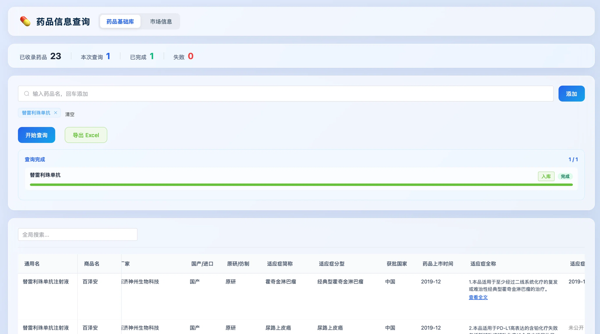
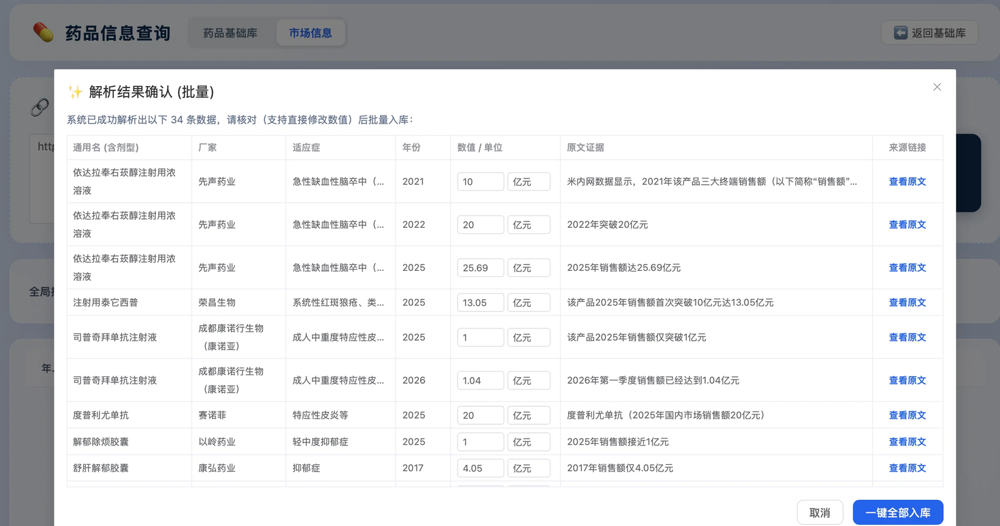
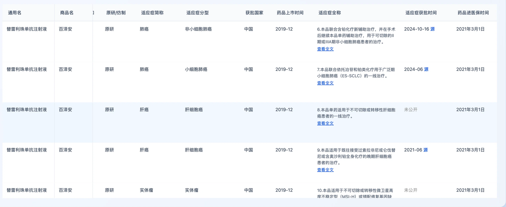
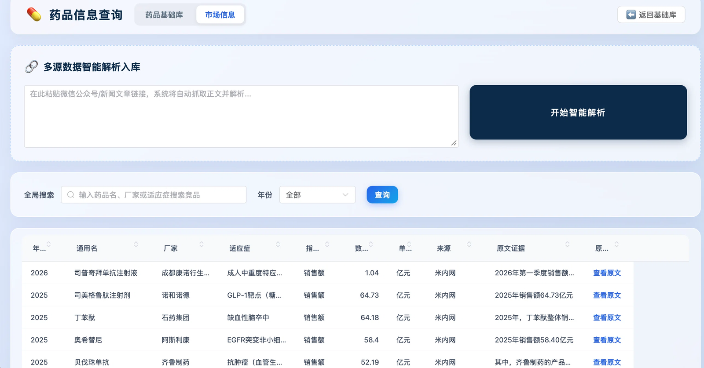

# YPCX — 药品情报 Agent

**把国家医保局的 PDF / PPT / 网页，变成一条可复核、可追溯的药品结构化记录。**

做医药市场分析最耗时的活，是从医保局申报材料、CDE 说明书和零散的网页里，把同一款药的厂家、
适应症、用法用量、医保支付限制、获批时间抄成一行能用的数据。材料格式不统一，同一款药在不同
年份的目录版本里名称和支付范围还会变——人工做既慢又容易错，错了还很难发现。

YPCX 把这条链路做成流水线：抓取 → 双通道解析（文本 / 视觉）→ 字段抽取 → 校验与对齐 →
人工复核 → 入库 → 前端查询与导出。

## 界面

**① 录入与查询**：输入药品名 → 抓取解析 → 进度可见 → 一键导出 Excel。



**② 解析结果确认（人工闸门）**：模型解析出的每条数据都带着原文证据，可以逐条改数值，
确认后才入库——模型不直接写库。



**③ 药品基础库**：一款药的**每个适应症各占一行**，一行就是「药品 × 适应症」这个粒度。
每行带三级适应症口径（简称 / 分型 / 申报原文全称）、获批国家、药品上市时间、这一条适应症的
获批时间，以及这一条适应症的进/出医保状态。所以同一款药会出现多行——替雷利珠单抗单药就有
14 条适应症记录。



**④ 市场情报**：从文章里抽出销售额、年份、指标，同样保留原文证据。



> 同一款药会出现多行：一行对应一个适应症（替雷利珠单抗单药就有 14 条），不是重复数据。
> 当前样本规模：23 个药品 / 85 条适应症记录。

## 数据模型

一条记录 = **一个药品 × 一个适应症**，不是"一个药品一行"。这是刻意的：同一款药的
不同适应症在获批时间、医保状态、用法用量上都不一样，合成一行就再也拆不开。

| 分组 | 字段 | 说明 |
|---|---|---|
| 身份 | `generic_name` / `brand_name` / `manufacturer` | 通用名 / 商品名 / 厂家 |
| 身份 | `origin_region` / `origin_type` / `dosage_form` / `specification` | 国产进口 / 原研仿制 / 剂型 / 规格 |
| 适应症 | `indication_short` | 简称，用于聚合与筛选（肺癌、肝癌） |
| 适应症 | `indication_subtype` | 分型，用于实体对齐（非小细胞肺癌、肝细胞癌） |
| 适应症 | `indication_full` | 申报原文全称，保留编号与限定条件，不加工 |
| 时间线 | `china_approval_date` | 药品上市时间 |
| 时间线 | `indication_approval_date` | **这一条**适应症的获批时间 + `indication_approval_source` 来源链接 |
| 时间线 | `drug_insurance_date` / `insurance_status_text` | 药品进医保时间 / 这一条适应症的进·出医保年份 |
| 用法 | `dosage` / `dosage_single` / `frequency` / `route` / `duration` | 原文 + 拆出来的单次剂量、频次、途径、疗程 |
| 医保 | `insurance_category` / `insurance_restriction` / `price_insurance` | 甲乙类 / 支付限制原文 / 医保价 |
| 市场 | `price_market` | 市场价与规格（含来源口径） |
| 证据 | `nhsa_pdf_url` / `nhsa_ppt_url` / `guideline_name` / `guideline_recommendation` | 医保局 PDF、PPT 摘要、指南名称与推荐意见 |

### 四个时间点不是一回事

这是医药数据里最容易做错的地方，也是这套模型必须拆开的原因（以替雷利珠单抗为例）：

| 时间点 | 含义 | 例子 |
|---|---|---|
| 药品上市时间 | 整个药品**首次**在中国获批，同药所有适应症共用 | 2019-12 |
| 适应症获批时间 | **这一条**适应症获批的时间，同药不同适应症不同 | 围术期 NSCLC：2024-10 |
| 药品进医保时间 | 药品**首次**进入医保目录 | 2021-03-01 |
| 适应症进/出医保 | **这一条**适应症的目录状态，会随年份进出 | 2021 进入 → 2026 退出 |

把「药品上市时间」当成「适应症获批时间」是行业里的常见错误，会让"这个适应症到底哪年能用"
整条结论作废。

### 字段覆盖率（当前 85 条已入库记录）

| 字段 | 覆盖率 | 说明 |
|---|---|---|
| 通用名 / 商品名 / 厂家 / 剂型 / 适应症三级口径 | 100% | 这是主键，缺一条就不该入库 |
| 药品上市时间 / 药品进医保时间 | 100% | 来自目录与申报材料 |
| 医保局 PDF / PPT 链接 | 91% | 少数药品只有其中一种材料 |
| 规格 / 用法用量原文 | 92% | |
| 市场价格 | 84% | |
| 医保类别 / 支付限制 | 69% | 未进医保的品种没有 |
| 指南名称 | 59% | |
| 适应症获批时间 | 44% | 正在补，见 Roadmap |
| 疗程 | 29% | 原文经常只给"直至进展" |
| 医保价 | 11% | 多数不公开 |

> 覆盖率不是 100% 是**故意的**：查不到来源的字段一律留空，不让模型猜。
> "宁可有空格子，也不要有一个看起来很对但没出处的数"——这是这套系统的第一条规矩。

## 三个关键设计

**1. 模型只提案，代码来裁决。** LLM 输出全部过 Pydantic 校验，配 json-repair 兜底和失败重试；
三次不过落人工。模型永远不直接写库。

**2. 结论必须能回到原文。** 每次抓取都存快照（URL、抓取时间、原文、hash），字段挂原文页码；
定位不到原文的标记为待核，不进查询结果。

**3. 冲突不静默合并。** 同一事实在申报材料、说明书、网页里说法不一致时，按来源权威度和时间
新旧选主值，其余进冲突表转人工；人工裁决结果反哺规则。

## 架构

```text
国家医保局 / CDE / 网页
        │
        ├── PDF / PPT ── 文本层（PyMuPDF / pdfplumber）
        └── 扫描件 ───── 视觉模型（Qwen-VL）
                 │
            字段抽取（DeepSeek）
                 │
    Pydantic 校验 → 规则 / 本体对齐 → 冲突检测
                 │
        草稿 → 人工复核 → 已入库
                 │
    SQLite → FastAPI / SSE → Vue 宽表 / Excel
```

技术栈：FastAPI、SQLAlchemy、SQLite、SSE、Vue 3 / Element Plus、PyMuPDF。

> 个人项目，2026-10 起设计与原型，11 月起进入实现；当前为单机运行版本。

## 快速启动

```bash
git clone git@github.com:heidi-lu/YPCX.git
cd YPCX

python3 -m venv venv
source venv/bin/activate
pip install -r requirements-dev.txt

cp .env.example .env
# 编辑 .env：至少填 MAIN_LLM_API_KEY；读 PDF 再填 VISION_API_KEY

uvicorn main:app --reload --port 8000
```

前端不需要单独起静态服务。直接用浏览器打开 `index.html`，它会请求 `http://127.0.0.1:8000`。

## 在 VS Code 启动

不需要额外插件，VS Code 自带任务和调试器就够了。

### 点击启动（推荐）

按 `Cmd + Shift + B` 启动：

```text
dev: backend  -> 127.0.0.1:8000
dev: market   -> 127.0.0.1:8001
```

两个服务会分别在集成终端里启动，日志直接可见。

按 `F5` 只启动主后端 `FastAPI: uvicorn`，不启动市场服务。

停止：在对应终端里按 `Ctrl+C`。

### 自动启动

VS Code 没有必要的“自动启动插件”。如果确实要打开项目就启动，可以在 `.vscode/tasks.json` 的 `dev: start` 上加：

```json
"runOptions": { "runOn": "folderOpen" }
```

但不建议默认开启：多个窗口会抢 8000 端口。

真正登录自启用 macOS `launchd`，见 [docs/launchd.md](docs/launchd.md)。

## 环境变量

见 [`.env.example`](.env.example)。主要配置：

| 变量 | 用途 |
|---|---|
| `MAIN_LLM_API_KEY` / `MAIN_LLM_BASE_URL` / `MAIN_LLM_MODEL` | 主文本模型 |
| `MARKET_LLM_*` | 市场信息抽取模型（可复用主模型） |
| `SEARCH_API_KEY` / `SEARCH_BASE_URL` | 搜索服务 |
| `VISION_API_KEY` / `VISION_BASE_URL` / `VISION_MODEL` | 视觉模型（DashScope / Qwen-VL） |
| `DATABASE_URL` | 可选；默认项目目录下 `drug_agent.db` |
| `REDIS_*` | 可选；无 Redis 时自动走内存缓存 |

`.env` 已被 `.gitignore` 忽略，不要提交。

## 数据

- `nhi_dictionary.json`：医保字典，由 `build_dict.py` 从原始 CSV 生成；
  当前已提交，保证 clone 后可直接运行。时间轴和 `first_execution_date` 使用
  CSV 的 **执行时间**，不是文件名/目录年份；名称归一会合并 `aliases`。
- `medical_aliases.json` / `origin_manufacturers.json`：同义词与原研厂家字典，提交。
- `nhi_excels/`、`nhsa_split/`、PDF/PPT、`*.db*`：本地数据，不提交。
- 原始数据更新后：

```bash
python build_dict.py
```

## 测试与检查

```bash
pip install -r requirements-dev.txt
ruff check .
pytest -q
```

CI 配置在 [`.github/workflows/ci.yml`](.github/workflows/ci.yml)，push 和 PR 都会运行
ruff + pytest。

## 项目结构

```text
main.py                 FastAPI 路由、SSE、数据库读写
agent.py                药品抽取主流程
nhsa_crawler.py         医保局页面抓取
deepseek_search.py      搜索封装
approval_dates.py       网搜获批日期（证据句 + 双来源）
disease_terms.py        病名字典/缩写统一入口
skill_vision_parser.py  PDF/图片视觉解析
models.py / db.py       SQLAlchemy 模型与 Session
build_dict.py           由医保 CSV 生成 nhi_dictionary.json
market_module/          市场数据模块
index.html              主页面
market.html             市场页面
tests/                  离线冒烟测试
```

## API

- `GET /query/stream?drug_names=药A,药B`：SSE 查询流
- `GET /drugs`：药品行列表
- `GET /docs`：FastAPI 自动文档

## 开发约定

- 不提交 `.env`、`*.db*`、`venv/`、原始 PDF/PPT、`nhi_excels/`、`nhsa_split/`。
- 外部数据保留来源 URL；没有来源的字段留空，不编造。
- 修改抽取字段时同步检查 `agent.py`、`models.py` 和前端列定义。
- 改完代码至少跑 `ruff check .` 和 `pytest -q`，再提交。
- 提交前用 `git diff` 检查，不要把密钥或本地数据带进去。

## 已知限制

- **NHSA**：同一药品通常有 PDF 和 PPT 两份材料；PPT 第一页常含首次上市时间、
  注册规格、拟新增适应症和用法用量，不能只读 PDF。PDF/PPT 优先读文本层，
  扫描件才回退视觉模型。
- **CDE**：存在反爬，说明书链接可能为空，不应阻塞主流程。
- **SSE**：查询流会保持长连接；反向代理需要关闭缓冲。
- **SQLite**：单机使用；多进程写入需要额外并发控制。

## Roadmap

- [ ] 获批时间的证据裁决：当前仍有记录为空，计划改成「引文 + 双来源」判定
- [ ] 简称 / 分型按疾病词表做二次归一，减少同义写法
- [ ] 向量检索：当前规模下字典 + 别名足够，超过一定量级再引入
- [ ] 多用户权限与操作审计

## 相关文档

- [`AGENTS.md`](AGENTS.md)：项目内的开发约定与目录说明。
- [`docs/nhi_normalization_spec.md`](docs/nhi_normalization_spec.md)：医保目录名称归一规则。
- [`HANDOFF.md`](HANDOFF.md)：当前进度与已知缺口（持续更新）。

## 成本与用量（P0）

每次 LLM / 搜索调用都会写一条记录，用于核算单药成本、定位高消耗阶段。

- 表：`llm_usage`、`search_usage`（`init_db()` 自动创建，不动 `drugs`）
- 接口：
  - `GET /stats/cost?days=7`：按模型 / 阶段 / 药品聚合
  - `GET /stats/usage?limit=50`：最近调用明细
- 价目表：`config.LLM_PRICES`、`config.SEARCH_PRICES`（2026-11 官方价，改价只改这里）
- 开关：`USAGE_LOG_ENABLED=0`、`SNAPSHOT_ENABLED=0`
- 快照：`snapshots/`（搜索命中、LLM 输入输出、PDF/PPT 字节），已加入 `.gitignore`

### 切换模型

默认全部沿用 `MAIN_LLM_MODEL`。换千问时只改环境变量：

```bash
EXTRACT_MODEL=qwen3.8-flash
SHORT_MODEL=qwen3.7-flash
THINK_MODEL=qwen3.8-flash
QWEN_LLM_API_KEY=...   # 默认复用 VISION_API_KEY
```

### 离线工具

```bash
# 只读：存量简称/分型回填预演，出 diff 报告
./venv/bin/python scripts/backfill_diff.py

# 冻结当前输出作为基线（不是正确答案）
./venv/bin/python scripts/make_baseline.py

# 用快照回放一次查询（不联网、不付费）
./venv/bin/python scripts/replay_query.py 替雷利珠单抗
```

> 注意：回放会跳过 VLM（用空结果代替），只验证“正则 + 组装”链路；需要完整回放时先正常跑一次生成快照。

## Docker

```bash
cp .env.example .env   # 填 key
mkdir -p docker-data snapshots reports
cp drug_agent.db docker-data/drug_agent.db   # 可选：复用现有库
docker compose up -d --build
```

API：<http://localhost:8000>；前端直接打开 `index.html`，或 `docker compose --profile web up -d` 用 8080。
详见 [docker/README.md](docker/README.md)。
